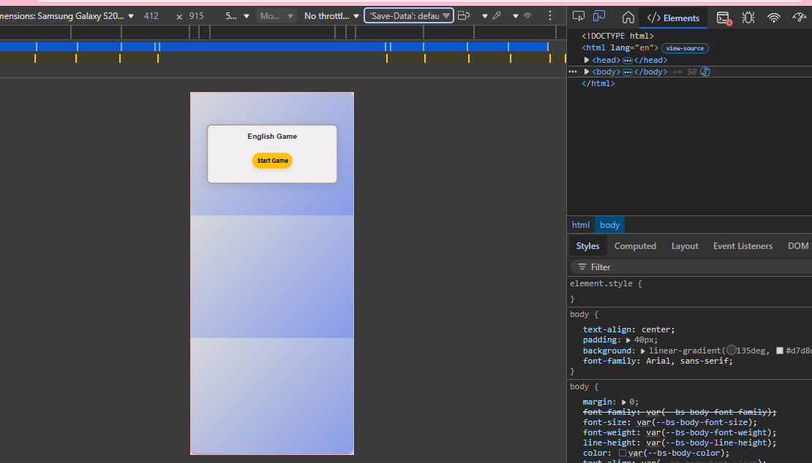

# English Game

An interactive web-based game for practicing English sentences, designed for children (Year 5–6) and beginner learners.

## Pages

`index.html` is the main menu. Each topic page has topics → games (two-level menu).

| Page | What's inside |
|------|---------------|
| `challenge.html` | Random Challenge: random mixes from every topic (quick 5, tenses, words, grammar, writing, big test) |
| `tenses.html` | Classic Tense Game: reading text, fill in the blank, sentence order (all 12 tenses) |
| `tense-workshop.html` | Time detective, verb doctor, spot the tense, negatives, questions, mixed tenses, signal words, tense table |
| `vocabulary.html` | The Year 3–4 and Year 5–6 statutory words (meaning, gap fill, guess, unscramble, word list) and irregular verbs |
| `spelling.html` | Correct spelling, missing letters, listen & spell, spot the mistake, plurals, -ing/-ed, suffixes, tricky endings, ie/ei, -ough, silent letters, homophones |
| `grammar.html` | Prefixes & suffixes, conjunctions & openers, reference words, modal verbs, auxiliary verbs & question tags, question words, comparatives & superlatives |
| `writing.html` | Story structure (introduction, development, climax, ending), speech marks, punctuation, contractions, story writer and dialogue writer with automatic checklist |

## How to Play

1. Open `index.html` in your browser (no server needed).
2. Choose a topic, then a game.
3. Wrong answers show the rule; at the end you see your score and what to learn.
4. Questions are chosen at random, and the game remembers which ones you have seen, so new ones come first.

## File Structure

- `js/english-game.js` – the classic Tense Game
- `js/quiz-engine.js` – shared quiz engine for all other pages (choice, typing, listening, ordering)
- `js/data/words.js`, `js/data/words34.js` – Year 5–6 and Year 3–4 word lists; `js/data/verbs.js` – irregular and regular verbs
- `js/pages/*.js` – the games and question banks of each page
- `style.css` – base style; `pages.css` – menu, quiz and writing tool styles

## Extending the Game

- Add a question to a bank in `js/pages/<page>.js`, or a new game object to a section's `games` list.

## Requirements

- Modern web browser (Chrome, Firefox, Edge, Safari, etc.)

## Screenshot

Mobile view shown in browser DevTools:

---

## UX 5 Plan (Jesse James Garrett model)

### 1. Strategy

- **Goal:** Help children (8–12) and beginners practice English sentences in a fun, interactive way.
- **User needs:** Motivation, engagement, instant feedback, simple operation.

### 2. Scope

- **Features:**

- Fill in the blank and sentence order game modes
- 100+ random sentences per session
- Easy/Hard difficulty
- Sound feedback
- Colorful, accessible design

### 3. Structure

- **Information architecture:**

- Home: Difficulty and mode selection
- Game: Question display, answer options, feedback

- **Interaction design:**

- Click/tap to select answers and navigate

### 4. Skeleton

- **Layout:**

- Central container with title, controls, game area, feedback
- Large, touch-friendly buttons
- **Navigation:**
- Simple, always visible mode and difficulty selectors

### 5. Surface

- **Visual design:**

- Bright, playful colors
- Rounded buttons, clear fonts
- Immediate visual and audio feedback

---

## Credits

- Developed for English language practice for children.
- Sentence generation and design by AI (GitHub Copilot)
